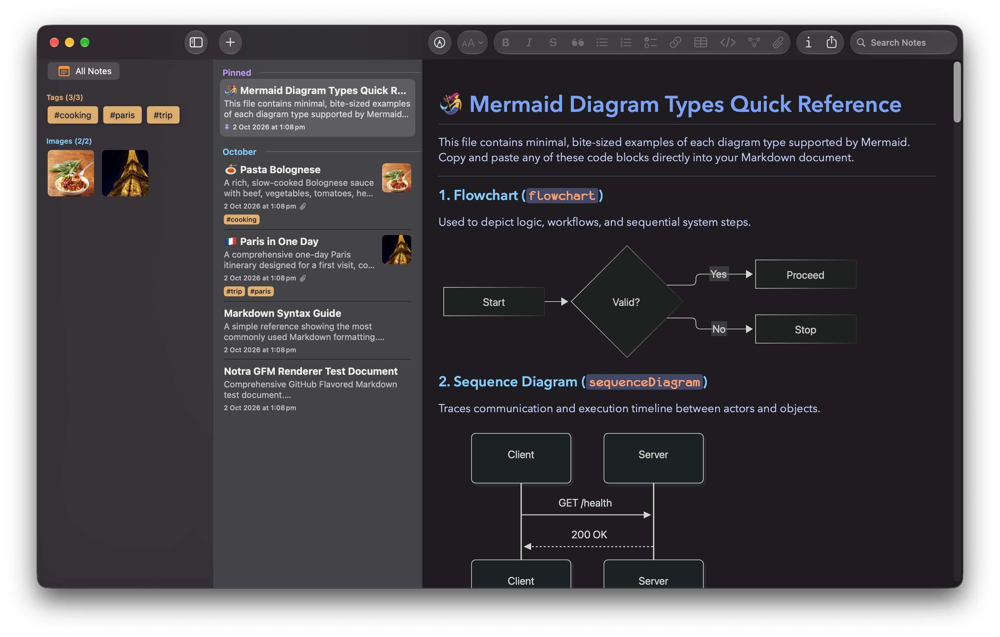
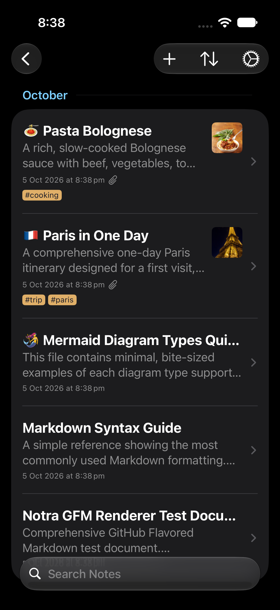

# Notra

Notra is a SwiftUI notes app for iOS, iPadOS, and macOS. Notes are stored as TextBundle documents with Markdown content and local assets.

## Download

### Free Mac development build

[Download a development build from GitHub Releases](https://github.com/akopulko/notra/releases) to try Notra's editing and organisation features.

- Requires an **Apple silicon Mac (M1 or later)** running **macOS 26 or later**. Intel Macs are not supported by GitHub downloads.
- Notes are stored **locally only**, without iCloud sync.
- Signed with an **Apple Development certificate**, but **not notarised**. macOS may block the first launch.
- Install **Notra Preview.app** separately from the full App Store edition. Download updates manually from Releases.

### Full App Store edition

[Get Notra on the App Store](https://apps.apple.com/app/notra-markdown-notes/id6809414279) for **Mac, iPhone, and iPad**, with local storage and iCloud sync using your own iCloud storage. **One purchase. No subscription.**

<p>
  <a href="https://apps.apple.com/app/notra-markdown-notes/id6809414279">
    
  </a>
</p>

| | GitHub development build | App Store edition |
|---|---|---|
| Devices | Apple silicon Mac only | Mac, iPhone, iPad |
| Storage | Local only | Local and iCloud |
| Installation | ZIP download; security approval may be required | App Store |
| Updates | Manual download | App Store |
| Price | Free | One-time purchase |

The source remains open source, including the optional iCloud configuration for developers building with their own signing credentials. GitHub downloads do not impose a time limit or note limit.

### Installing a development build

1. Download the ZIP and `SHA256SUMS.txt` from the same release. In their download folder, run `shasum -a 256 -c SHA256SUMS.txt`.
2. Extract the ZIP and move **Notra Preview.app** to Applications. Do not replace **Notra.app** from the App Store.
3. Try opening the preview. If macOS blocks it, review [Apple's instructions for opening an app from an unknown developer](https://support.apple.com/guide/mac-help/open-a-mac-app-from-an-unknown-developer-mh40616/mac).
4. If you trust this download, use **System Settings → Privacy & Security → Open Anyway** when offered. Managed Macs may prohibit this exception.

Development signing is not notarization or App Review. Do not disable Gatekeeper globally or remove quarantine attributes to install the preview.

### Moving notes to the App Store edition

The editions use separate sandbox libraries and preferences. **Preview notes do not migrate automatically.**

1. Let your notes finish saving. In each edition, use **Settings → General → Open Library Location** to reveal its active library.
2. Back up both libraries, then quit both apps.
3. Copy complete `.textbundle` documents from the preview backup into the Store edition's library. Keep their `assets` folders; copying only Markdown can lose attachments. Do not overwrite existing bundles.
4. Relaunch the Store edition and verify the notes and attachments before deleting any preview data. If its active library uses iCloud, also verify sync on your other device.

## Screenshots

Notra keeps the same focused writing workflow across Apple devices.

<p align="center">
  
</p>

<p align="center">
  
  
</p>

See the [privacy policy](docs/privacy.html) used for the App Store submission.

## Requirements

- Xcode 27 with iOS 27 and macOS 27 SDKs
- SwiftFormat and SwiftLint available on your PATH

Markdown parsing uses [Swift-Markdown](https://github.com/swiftlang/swift-markdown) with a minimum version of 0.9.0. The shared `Package.resolved` pins both Swift-Markdown and its Swift-cmark dependency to 0.9.0 for reproducible builds.

## Build

Run validation builds before opening a pull request:

```sh
make build
```

This builds iOS first, then macOS. To build one platform at a time:

```sh
make build-ios
make build-macos
```

The build targets run SwiftFormat and SwiftLint in lint mode before compiling.

## Run

The run targets build the selected Debug app before launching it and stream logs. If the ignored `Config/LocalSigning.xcconfig` exists, they sign the build automatically; otherwise they use an unsigned build:

```sh
make run-ios
make run-ios-ipad
make run-ios-duo
make run-macos
```

`make run-ios` uses the iPhone 17 simulator on iOS 27. The iOS run targets use simulators. For a physical iPhone or iPad, open `Notra.xcodeproj` in Xcode and run the `Notra` scheme on the device.

To override the automatic signing choice:

```sh
CODE_SIGNING_ALLOWED=NO make run-macos
CODE_SIGNING_ALLOWED=YES make run-ios
```

## Local Signing and iCloud

The public project uses local-only storage by default and does not include a personal Apple Developer Team ID or iCloud container.

For private local signing, copy `Config/LocalSigning.xcconfig.example` to `Config/LocalSigning.xcconfig` and set your own values. The local file is ignored by git.

For private iCloud development:

```sh
cp Config/LocalSigning.xcconfig.example Config/LocalSigning.xcconfig
cp Config/LocalInfo-iCloud.plist.example Config/LocalInfo-iCloud.plist
```

Then replace the placeholder values with your own Apple Developer Team ID, bundle identifier, and iCloud container. Both local files are ignored by git.

Build scripts default to unsigned builds. Override signing explicitly when building:

```sh
CODE_SIGNING_ALLOWED=NO make build-macos
CODE_SIGNING_ALLOWED=YES make build-ios
```

## Contributing

Use focused branches and keep changes small. Before opening a pull request, run both build scripts, run `NotraTests` in Xcode, and make sure there are no warnings, SwiftFormat issues, SwiftLint violations, or failing unit tests.

Install the local pre-commit privacy hook before your first commit:

```sh
Scripts/install_git_hooks.sh
```

The hook blocks staged local signing files, iCloud identifiers, Apple Developer Team IDs, credentials, private keys, crash reports, logs, databases, local Xcode state, and local user paths. It also reads your ignored local signing config at runtime and blocks those private values if they accidentally appear in staged files.

Do not commit local signing configuration, generated build output, crash reports, logs, personal notes, or private data.

Apple, the Apple logo, Mac, iPhone, and iPad are trademarks of Apple Inc., registered in the U.S. and other countries. App Store is a service mark of Apple Inc. The official download badge is used under [Apple's marketing guidelines](https://developer.apple.com/app-store/marketing/guidelines/).
